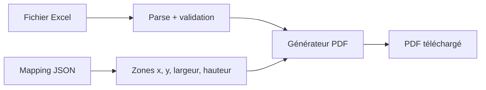

# AutoRemise

**PFA — génération automatique de remises bancaires (chèques & effets) à partir d’un fichier Excel.**

Application web réalisée dans le cadre d’un Projet de Fin d’Année, en stage chez **Shamash Information Technology**. Elle transforme un fichier Excel de remise en PDF prêts à imprimer, avec un alignement au millimètre sur les documents bancaires tunisiens.

## Problème

Les remises de chèques et d’effets étaient préparées à la main : copier les données Excel, les reporter sur le bon formulaire, puis imprimer. Cela prenait du temps et produisait des décalages à l’impression (champs hors cases).

## Solution

AutoRemise automatise le flux :

1. L’utilisateur choisit la **banque** et le **type** (chèque ou effet)
2. Il importe le **fichier Excel** de la remise
3. L’application charge le **mapping** (positions des champs sur le document)
4. Elle génère un **PDF** aux dimensions réelles du papier, sans mise à l’échelle

Un **éditeur visuel** (rôle administrateur) permet de poser, déplacer et redimensionner les zones, puis d’exporter un nouveau template JSON.

## Fonctionnalités

- Import Excel (`.xlsx` / `.xls`) et validation des colonnes selon la banque
- Génération PDF (pdf-lib) avec dimensions en cm, pensée pour l’impression « taille réelle »
- Éditeur de templates : image ou PDF en fond, zones draggables (`react-rnd`)
- Plusieurs banques tunisiennes : AMEN, Al Baraka, Zitouna, BNA, UBCI, Banque de Tunisie
- PWA (installation, usage hors ligne une fois les templates chargés)
- Rôles démo : employé (génération) / administrateur (éditeur)

## Architecture



Tout s’exécute **dans le navigateur** : pas de backend, pas de base de données. Les templates sont des JSON (`zones` + image de fond en base64). Le générateur convertit les coordonnées de l’éditeur en points PDF.

| Couche | Rôle |
|--------|------|
| `app/Pages` | Écrans : accueil, connexion, éditeur |
| `app/hooks` | Workflow, génération PDF, PWA, rôles |
| `utils` | Excel, validation des en-têtes, dimensions |
| `public/mappings` | Templates par banque (non versionnés, voir ci-dessous) |

## Stack

- **Next.js 15**, **React 19**, **TypeScript**, Tailwind CSS
- **pdf-lib** (écriture PDF), **pdfjs-dist** (aperçu PDF dans l’éditeur)
- **xlsx** / **xlsx-populate** (lecture Excel)
- **react-rnd**, **framer-motion**
- **next-pwa**

## Lancer le projet

Prérequis : Node.js 18+.

```bash
git clone https://github.com/amelbenhazem/autoremise.git
cd autoremise
npm install
npm run dev
```

Ouvrir [http://localhost:3000](http://localhost:3000).

```bash
npm run build   # production
npm run start   # servir le build
npm run lint
```

### Comptes de démonstration

L’authentification est **volontairement mockée** (localStorage, hors scope du PFA : le besoin était le PDF, pas un SI utilisateurs).

| Rôle | Email | Mot de passe |
|------|-------|--------------|
| Employé | `employe@banque.com` | `employe123` |
| Administrateur | `admin@system.com` | `admin123` |

L’admin accède à `/template-editor`.

Pour tester une génération complète en local, placer les fichiers de mapping (fournis pendant le stage) dans `public/mappings/`. Un exemple de structure est versionné : [`public/mappings/exemple-demo.json`](public/mappings/exemple-demo.json).

Impression papier : [instructions](public/INSTRUCTIONS_IMPRESSION.md) — choisir **Taille réelle** / **Aucune mise à l’échelle**.

## Structure

```
autoremise/
├── app/                  # App Router, pages, composants, hooks
├── public/mappings/      # Templates JSON (ignorés par Git, sauf l’exemple)
├── styles/
├── types/
├── utils/
└── scripts/              # Icônes PWA, scaling de mappings
```

## Confidentialité

Les modèles de chèques et d’effets utilisés en entreprise **ne sont pas dans ce dépôt**. Ils restent en local (`public/mappings/*.json`, gitignorés). Le dépôt public ne contient qu’un JSON d’exemple, sans image de document bancaire.

## Licence

Projet de PFA / stage — usage démonstratif. Tous droits réservés.
